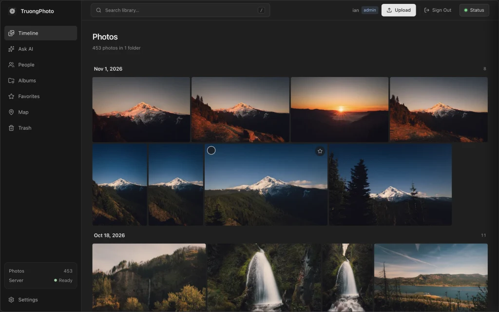
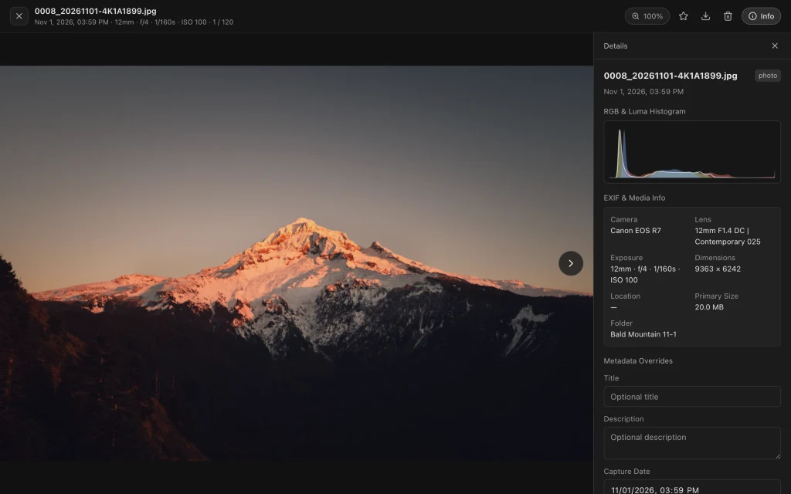
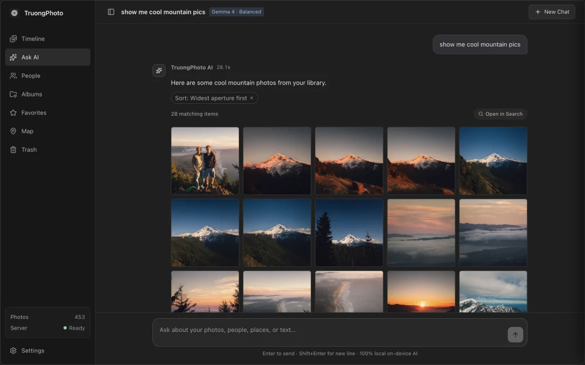
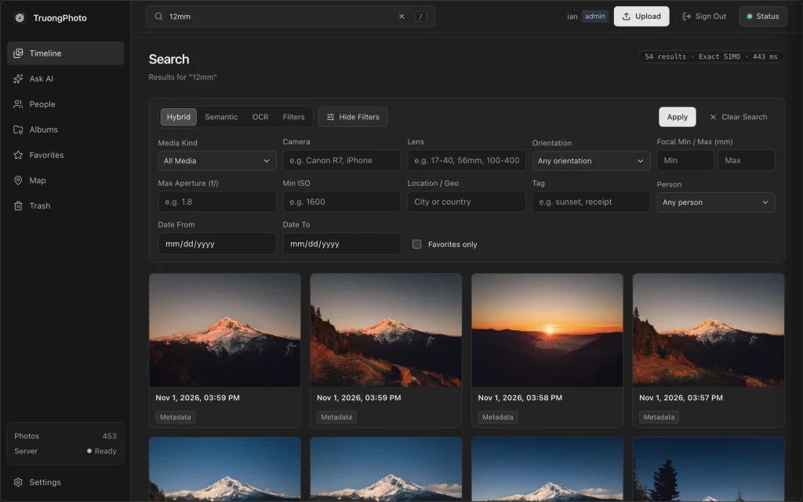
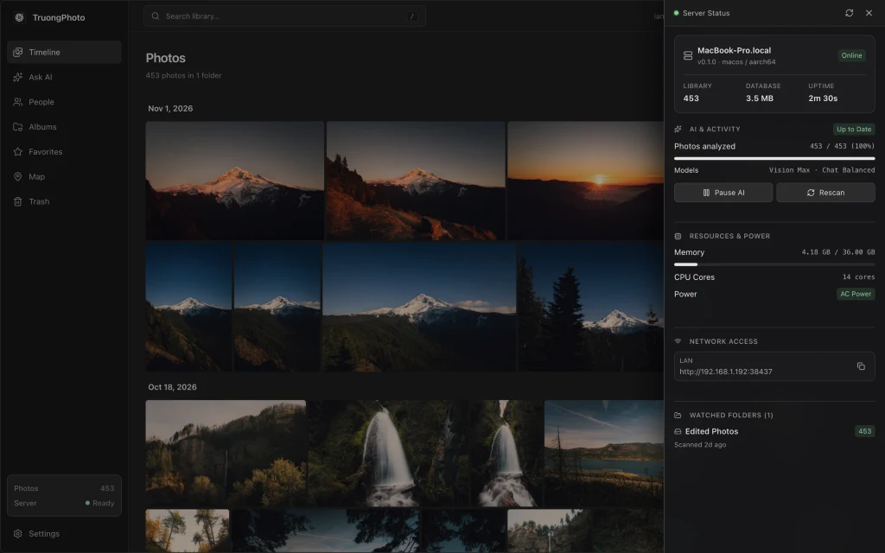
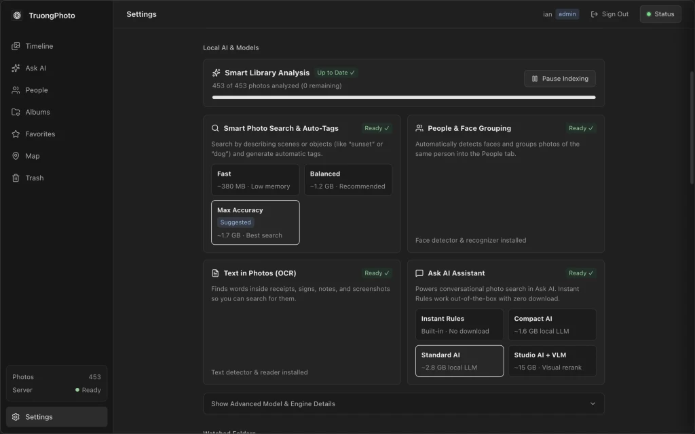

<div align="center">


# TruongPhoto

A native macOS and Windows local-first AI photo and video library built in Rust and Tauri 2 that combines multi-user folder-scoped RBAC, offline semantic search, face clustering, scene OCR, conversational GGUF filtering, an offline world map, and Tailscale HTTPS remote access inside a unified dark studio interface.

[Download for macOS](https://github.com/iant4093/TruongPhoto/releases/latest/download/TruongPhoto-macOS.dmg) · [Download for Windows](https://github.com/iant4093/TruongPhoto/releases/latest/download/TruongPhoto-Windows-Setup.exe) · [Releases](https://github.com/iant4093/TruongPhoto/releases) · [Build status](https://github.com/iant4093/TruongPhoto/actions) · [Report an issue](https://github.com/iant4093/TruongPhoto/issues)

[](https://github.com/iant4093/TruongPhoto/releases/latest/download/TruongPhoto-macOS.dmg)
[](https://github.com/iant4093/TruongPhoto/releases/latest/download/TruongPhoto-Windows-Setup.exe)


_%7C_Windows_x64-555555)
[](https://github.com/iant4093/TruongPhoto/actions/workflows/ci.yml)

</div>

---

TruongPhoto indexes, searches, and streams your photo and video archive directly from your own disks on both macOS and Windows without cloud accounts, telemetry, or external API dependencies. It pairs a high-concurrency SQLite WAL + FTS5 catalog and 3-tier camera RAW and video pipeline with an offline-first AI engine (`SigLIP2` semantic embeddings, `YuNet` + `AuraFace-v1` face clustering, `PP-OCRv6` text recognition, and local GGUF conversational search via `llama.cpp`), all wrapped in an Apple-grade dark studio interface that runs identically as a native desktop app or as a headless server (`http://127.0.0.1:38420`, advertised on LAN via mDNS as `truongphoto.local`) for browsers and mobile PWAs. Releases target Apple Silicon Macs and 64-bit Windows.

Every media folder remains in place on disk while TruongPhoto maintains non-destructive WebP thumbnails, metadata, and memory-mapped vector indices inside its local data directory. Multi-user family profiles enforce folder-scoped access at the SQLite query boundary (`rbac_folder_filter_sql`), while an RBAC-aware hybrid vector engine switches automatically between exact SIMD cosine scans for narrow folder subsets and memory-mapped `USearch` HNSW graph traversal for broad library searches. All AI models are strictly Apache-2.0 or MIT licensed and download on demand only when enabled in **Settings › Local AI & Models**.

## Screenshots

Screenshots capture the live dark studio UI running locally against a real photography library (Canon EOS R7) with local `SigLIP2` vision indexing and `Gemma 4` conversational routing enabled.

<table>
  <tr>
    <td width="50%" valign="top">
      
      <p align="center"><sub><b>Photos Timeline</b> · virtualized justified grid, date headers and zero-clutter dark chrome</sub></p>
    </td>
    <td width="50%" valign="top">
      
      <p align="center"><sub><b>Photo Viewer &amp; Inspector</b> · directional transitions, click-to-zoom hi-res, EXIF bar and live RGB histogram</sub></p>
    </td>
  </tr>
  <tr>
    <td width="50%" valign="top">
      
      <p align="center"><sub><b>Ask AI (Local Gemma 4)</b> · natural-language search, removable filter chips and Open in Search</sub></p>
    </td>
    <td width="50%" valign="top">
      
      <p align="center"><sub><b>Hybrid &amp; EXIF Search</b> · semantic, OCR and deterministic camera/lens/EXIF filtering</sub></p>
    </td>
  </tr>
  <tr>
    <td width="50%" valign="top">
      
      <p align="center"><sub><b>Server Status &amp; Telemetry</b> · live AI progress, RAM/power state, LAN address and watched folders</sub></p>
    </td>
    <td width="50%" valign="top">
      
      <p align="center"><sub><b>Local AI &amp; Models</b> · simple on-demand presets for SigLIP2, AuraFace, PP-OCRv6 and Gemma 4</sub></p>
    </td>
  </tr>
</table>

## Features

**Stage 1 Ingestion, Asset Stacking & 3-Tier RAW/Video Pipeline**

- Live filesystem watching (`notify`) with 500 ms debounce, volume UUID tracking for external drives, fast 128 KB head/tail pre-hashing, full `BLAKE3` content hashing, and 64-bit dHash perceptual duplicate detection
- Automatic `RAW+JPEG`, burst sequence, and Apple/Android Live Photo (`ContentIdentifier` / `MicroVideo`) stacking with instant format badge switching in the lightbox
- 3-tier camera RAW pipeline (`CR2`, `CR3`, `NEF`, `ARW`, `DNG`, `RAF`, `ORF`, `RW2`, `PEF`) with embedded JPEG preview extraction for instant thumbnails, native OS codecs (`sips` / ImageIO on macOS, WIC on Windows), and dynamic `LibRaw` loading (`libraw.dylib` / `libraw.dll`), plus JPEG XL (`jxl-oxide`) and ICC v2/v4 color management (`moxcms`) to sRGB
- EXIF, XMP sidecar, and QuickTime metadata extraction (`nom-exif`) with offline reverse geocoding against a bundled GeoNames `cities1000` spatial dataset (nearest city, admin1 region, and country with zero network calls)
- Hardware-accelerated video poster extraction and on-demand HLS adaptive streaming (`VideoToolbox` on macOS, `NVENC`/`QSV`/`AMF` on Windows, or `libopenh264` fallback) played back seamlessly via `hls.js`
- Virtualized justified timeline (`@tanstack/react-virtual`) maintaining 60 FPS across 500,000+ assets with smooth directional Lightbox transitions, progressive hi-res click-to-zoom, live RGB + luminance histogram, and multi-select batch toolbar

**100% Offline AI: Semantic Search, People Clustering & In-Image OCR**

- Dynamic ONNX Runtime loading (`ort` with `load-dynamic`) driving CoreML on Apple Silicon and DirectML on Windows GPUs without hard compile-time binary coupling
- **Semantic Vision & Video Keyframe Search**: selectable `SigLIP2` tiers (`SigLIP2-Base` 768-d, `SigLIP2-Large` 1024-d, `SigLIP2-So400m` 1152-d) indexing both photos and scene-change video keyframes, plus zero-shot auto-tagging against a curated 256-prompt photography taxonomy
- **RBAC-Aware Hybrid Vector Engine**: memory-mapped `USearch` `f16` HNSW base index paired with a live RAM delta buffer and `RoaringBitmap` tombstones—dynamically routing narrow `< 2,000`-asset or `< 2%` RBAC selectivity queries to an exact SIMD scan (100% recall) and broad queries to filtered HNSW search
- **People & Face Clustering**: `YuNet` 5-point landmark detection, 5-point similarity Umeyama alignment (`112×112`), `AuraFace-v1` 512-d embeddings, and incremental cosine centroid clustering (`threshold = 0.58`) with cluster naming, merge, split, and cover photo selection
- **Scene Text OCR (`PP-OCRv6`)**: DBNet text box detection and SVTR-LCNet character recognition indexed directly into SQLite `FTS5` with selectable bounding-box overlays in the lightbox
- Reciprocal Rank Fusion (`RRF`, `k = 60`) combining semantic vector similarity, FTS5 BM25 text/OCR matches, face cluster hits, and structured metadata filters in a single ranked response

**Conversational Query Router & Offline-First Map View**

- Dedicated full-page **Ask AI** workspace (`Cmd/Ctrl+K`) with multi-turn refinement, removable filter chips, `"Open in Search"` handoff, and library-aware conversational answers (e.g., *"who are in my pics"*, *"show me cool mountain pics"*, *"widest angle waterfall shots"*, *"56mm f/1.4"* followed by *"remove the location filter"*)
- 4-tier local chat routing: Tier 0 zero-RAM deterministic parser (`ClassicChatRouter`), plus Tier 1 (`Gemma 4 E2B` / `Qwen 3.5 4B`), Tier 2 (`Gemma 4 E4B`), and Tier 3 (`Gemma 4 26B-A4B MoE` with multimodal VLM top-24 thumbnail reranking) via a managed `llama-server` sidecar or optional compiled `llama-cpp-2` (`llama-metal` / `llama-vulkan-dl`)
- Interactive **Map View** powered by `MapLibre GL JS` and SQLite grid-snapped spatial clustering (`asset_geo_index`), updating the photo sidebar live as you pan and zoom
- Offline-first basemap architecture: bundled Natural Earth 110m vector land/ocean polygons work out of the box, with support for a local `world-z0-z6.pmtiles` world archive and a strict opt-in toggle for online OpenFreeMap detailed street tiles

**Multi-User RBAC, Two-Layer PIN Auth & Tailscale HTTPS**

- Multi-user profiles (`Admin`, `Member`, `Guest`) where each profile is granted access only to its assigned root folders (`user_folder_grants`), enforced across every timeline, search, album, face, map, and vector endpoint
- Two-layer authentication: optional global 4–8 digit **Server Lock PIN** for LAN/Tailscale entry plus per-profile **Argon2id PINs** backed by 256-bit `HttpOnly; SameSite=Strict` session cookies and brute-force rate limiting
- Smart dynamic albums (JSON filter rules evaluated live) alongside manual albums and family shared albums (`album_shares`)
- One-click **Tailscale Remote HTTPS** automation (`tailscale serve --bg --https=443 http://127.0.0.1:38420`) with platform diagnostics (detecting Mac App Store sandbox limits or Windows operator permissions) and pure-Rust SVG QR code pairing (`GET /api/system/qr`)
- Installable mobile PWA (`manifest.webmanifest`) with touch gestures and responsive bottom-tab navigation for iOS and Android over LAN or Tailscale

**Menu Bar / System Tray, Smart Throttling & Rolling Backups**

- Dedicated Menu Bar (macOS) and System Tray (Windows) popover (`tray.html`) displaying live ingestion/AI queue progress, quick search, Pause / Resume AI workers, LAN & Tailscale URL copy, and an expandable mobile pairing QR card
- Automatic power and thermal throttling: `PowerWatcher` pauses background AI indexing on laptop battery or OS sleep/lock, while `SystemLoadMonitor` throttles worker concurrency when host CPU load exceeds 85%
- Automated online SQLite backups (`rusqlite::backup::Backup`) to a user-configured backup directory with rolling snapshot retention (`keep_last_n = 7`) and one-click manual trigger in **Settings › System & Backups**
- Strict HTTP hardening (`X-Content-Type-Options: nosniff`, `X-Frame-Options: DENY`, `Referrer-Policy: no-referrer`), navigation origin guards, and deterministic shutdown ordering

## Install

Download the latest installers from [GitHub Releases](https://github.com/iant4093/TruongPhoto/releases/latest). Installed apps update themselves from there.

**macOS** (Apple Silicon, macOS 14.0 or later)

1. Download [TruongPhoto-macOS.dmg](https://github.com/iant4093/TruongPhoto/releases/latest/download/TruongPhoto-macOS.dmg) and drag TruongPhoto into Applications.
2. Open TruongPhoto. macOS will say it can't verify the developer, because release builds are ad-hoc signed rather than notarized. Click **Done**, then go to **System Settings › Privacy & Security**, scroll down to the message about TruongPhoto and click **Open Anyway**, then confirm with your password. You only need to do this once.

**Windows** (x64, Windows 10 1809 or later / Windows 11)

1. Download [TruongPhoto-Windows-Setup.exe](https://github.com/iant4093/TruongPhoto/releases/latest/download/TruongPhoto-Windows-Setup.exe) and run it.
2. If SmartScreen appears, choose **More info › Run anyway**. The installer is not code-signed.

Core ingestion, timeline browsing, EXIF/XMP parsing, offline reverse geocoding, FTS5 search, Tier 0 conversational search, and the Natural Earth offline map work immediately with zero external downloads. AI vision/face/OCR/GGUF models can be downloaded individually inside **Settings › AI Models**. The download buttons always point to the most recent successfully published release.

Installed copies can check for updates from **Settings › System**, show what changed, and install the new release after verifying its signature.

## Tech stack

| Area | Technologies |
|---|---|
| App shell | Tauri 2 (Rust), WKWebView on macOS, WebView2 on Windows, standalone `truongphoto-server` CLI |
| Interface | React 19, TypeScript, Vite, Zustand, `@tanstack/react-virtual`, `lucide-react`, custom Apple neutral dark theme |
| HTTP & Realtime Server | `axum` 0.8 (`127.0.0.1:38420`), WebSocket progress bus (`/api/ws`), `mdns-sd` (`truongphoto.local`), `argon2` + `HttpOnly` sessions |
| Storage & Vector Search | SQLite (`rusqlite` bundled WAL + `FTS5` + online backup API), `USearch` memory-mapped `f16` HNSW index, `RoaringBitmap` RBAC filtering |
| Media & RAW Pipeline | `image`, `jxl-oxide` (JPEG XL), `moxcms` (ICC color management), `nom-exif`, dynamic `LibRaw` (`libloading`), `ffmpeg`/`ffprobe` HLS + `hls.js` |
| Offline AI & LLM Router | Dynamic `ort` (ONNX Runtime with CoreML / DirectML), `SigLIP2`, `YuNet`, `AuraFace-v1`, `PP-OCRv6`, `llama-server` sidecar & optional `llama-cpp-2` |
| Maps & Remote Access | `MapLibre GL JS`, `pmtiles`, bundled Natural Earth GeoJSON + GeoNames `cities1000`, Tailscale HTTPS (`tailscale serve`), SVG QR pairing |
| Delivery | GitHub Actions, macOS `.dmg`, Windows NSIS installer, signed auto-updates (`latest.json`), SHA-256 checksums |

## Build locally

Requires **Node 22.12+**, **Rust 1.90 or newer** (CI builds with 1.94.0) and the [Tauri prerequisites](https://v2.tauri.app/start/prerequisites/) for your platform.

```bash
npm install

# Desktop app with embedded Rust server and hot reload
npm run app:dev

# Frontend Vite dev server (pair with `cargo run -p truongphoto-server`)
npm run dev

# Run standalone headless server on http://127.0.0.1:38420
cargo run -p truongphoto-server

# Release build: builds installers, signs updates, writes latest.json
npm run app:build
```

Default Cargo builds require **no CMake** and run Tier 0 deterministic chat routing plus external `llama-server` sidecar GGUF inference. To compile optional in-process `llama-cpp-2` GGUF inference, pass `--features truongphoto-ai/llama-metal` on macOS or `--features truongphoto-ai/llama-vulkan-dl` on Windows.

`app:build` signs updates with `~/.tauri/truongphoto.key` or `$TAURI_SIGNING_PRIVATE_KEY`. Generate a key once with `npx tauri signer generate -w ~/.tauri/truongphoto.key`. Without it, use `npx tauri build --config '{"bundle":{"createUpdaterArtifacts":false}}'` for an unsigned local build.

## Tests

```bash
# Frontend unit and component tests (Vitest)
npm test

# TypeScript check and production frontend build
npm run build

# Rust format, strict Clippy lints, and workspace unit/integration tests
# (includes 20k synthetic scale regression, RBAC isolation, USearch hybrid search,
# RAW/ICC decode, EXIF/geocoding, OCR/face clustering, chat router, and HTTP routes)
cargo fmt --all -- --check
cargo clippy --workspace --all-targets --locked -- -D warnings
cargo test --workspace --locked

# Full 500,000-asset + 500,000-vector synthetic scale & 24-thread WAL concurrency soak test
cargo test --release -p truongphoto-server --test soak_500k -- --ignored --nocapture
```

## CI and releases

Pull requests and pushes to `main` run:

1. Vitest unit tests, a TypeScript check and a production frontend build.
2. macOS and Windows builds: `rustfmt` check, strict `clippy` lints across all workspace crates, Rust unit and integration tests, and Tauri installer packaging.

Pushes to `main` produce test installers in the Actions artifacts. After desktop acceptance testing, manually run **CI** on `main` with **publish** enabled to publish a GitHub Release `v<major>.<minor>.<run number>` containing `TruongPhoto-macOS.dmg`, `TruongPhoto-Windows-Setup.exe`, the macOS updater archive (`TruongPhoto-macOS.app.tar.gz`), `latest.json` (with the update signatures) and `SHA256SUMS`. The release notes are generated from the commit messages since the previous release, and the same list appears in the app's update prompt. Installed apps pick up the new version through `latest.json`. Pull requests and ordinary pushes never publish.

The updater signing key is stored as the `TAURI_SIGNING_PRIVATE_KEY` repository secret. Builds without it (such as fork pull requests) still produce installers, just without update signatures. GitHub Actions are pinned to commit SHAs, and Dependabot checks them weekly.

## Repository layout

```text
.
├── src/                    React app (Studio window, PWA client and Menu Bar / Tray popover)
│   ├── components/         Shared components: Sidebar, SearchFilterBar, JustifiedTimeline,
│   │                       TimelineScrubber, Lightbox, VideoPlayer, AssetInspector,
│   │                       InspectorDrawer, HistogramChart, ChatDrawer, AiModelsPanel,
│   │                       SearchResultsView, UploadModal, WindowControls, MobileTabBar
│   │   └── views/          Studio views: TimelineView, AlbumsView, PeopleView, MapView,
│   │                       FavoritesView, TrashView, SettingsView, SetupWizardView, PinGateView
│   ├── store/              Zustand stores (useAppStore.ts, feedback.ts)
│   ├── tray/               Menu Bar (macOS) / System Tray (Windows) quick-control popover
│   ├── lib/ types/         Typed HTTP/WebSocket API client (api.ts), justified layout solver,
│   │                       bundled Natural Earth GeoJSON, Tauri bridge, DTO types (types/api.ts)
│   └── styles/             Apple neutral dark theme (theme.css)
├── crates/                 Rust workspace crates
│   ├── truongphoto-core/   Shared config, DTO models, RBAC primitives, WebSocket event bus, errors
│   ├── truongphoto-db/     SQLite WAL + FTS5 pool, schema migrations, repositories, online backup
│   ├── truongphoto-media/  Image/RAW/JXL decode, ICC color management, EXIF/XMP, offline GeoNames
│   │                       reverse geocoder, FFmpeg/FFprobe video probing & HLS transcoding
│   ├── truongphoto-ai/     Dynamic ONNX Runtime (SigLIP2, YuNet, AuraFace-v1, PP-OCRv6), USearch
│   │                       hybrid vector engine, Tier 0–3 conversational query router (llama.cpp)
│   └── truongphoto-server/ Axum HTTP/WebSocket server, two-layer PIN auth, scanner & ingestion
│                           pipeline, AI worker supervisor, Tailscale HTTPS, QR pairing, mDNS,
│                           rolling backup scheduler, CPU/power load monitor, 500k soak suite
├── src-tauri/              Tauri 2 desktop host (truongphoto-desktop): embedded server lifecycle,
│                           Menu Bar / Tray host, OS sleep/battery watcher, updater & bundle config
├── tests/                  Vitest unit and component tests
├── scripts/                Release packaging and updater manifest generator (release.mjs)
├── public/                 App icon, favicon and mobile PWA manifest (manifest.webmanifest)
├── .github/                CI/release workflow and Dependabot
├── index.html              Main Studio window entry
├── tray.html               Menu Bar / System Tray popover entry
└── README.md
```

TruongPhoto is licensed under the MIT License. Optional AI models downloaded on demand (`SigLIP2`, `YuNet`, `AuraFace-v1`, `PP-OCRv6`, `Gemma 4`, `Qwen 3.5`) are licensed under Apache-2.0 or MIT by their respective authors, offline reverse geocoding uses GeoNames `cities1000` data (CC-BY-4.0), and optional `ffmpeg`/`ffprobe` and dynamically loaded `LibRaw` binaries are used as unmodified external/dynamic components under GNU LGPL-2.1.
